<h1 align="center">👋 Hi there, I'm Daniel Guillamón</h1>
<h3 align="center">💻 Web Development (DAW) Student from Spain 🇪🇸</h3>

---

### 📝 About Me

* 🌱 **Currently:** Pursuing a degree in **Web Application Development (DAW)** at ITB (2st year).
* 💡 **Interests:** Focusing on **Front-end Development** (HTML/CSS/JS) and **Mobile Programming** with Kotlin.
* 💬 **Ask Me About:** Academic projects, basic programming concepts, or anything related to web development.

---

### 🛠️ Languages and Tools

    
    
    
    
    

    
    
    
    
    

    
    
    
    

---

### 📊 My GitHub Activity and Stats

  
  &nbsp;&nbsp;&nbsp;
  

 

  

### 🌐 Connect With Me

    

        &nbsp;&nbsp;
    

    

    <small>Thanks for visiting my profile!</small>

